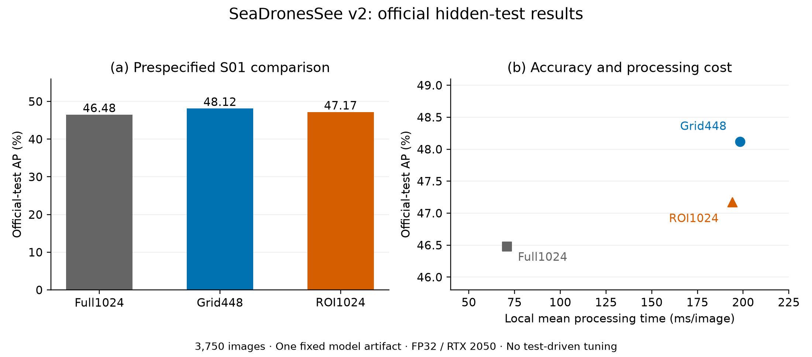

# SeaDronesSee compute audit

**An open research companion on computation, region selection and prediction
fusion in maritime small-object detection.**

Mehmet AKSOY · [ORCID](https://orcid.org/0009-0007-0250-8384)

**Status: interim research snapshot, 27 September 2026.** The study and final
academic English article are in progress. D-FINE evaluation and part of the
predeclared independent test remain pending. This repository claims neither a
new detector nor state-of-the-art performance. See [current status](CURRENT_STATUS.md).

## Research questions

1. Does selective cropping improve small-object detection at comparable measured
   processing cost, rather than only against an expensive exhaustive scan?
2. Which effects arise from resolution and crop count, and which from region selection?
3. How do fixed-threshold recall and COCO AP respond to learned selection,
   prediction fusion and coordinate conventions?
4. Do the conclusions persist across retained detector exports, source-video
   separation, a second architecture and the official hidden test?

The last question is only partly answered. Negative and null findings are retained.

## Available evidence

The completed development analysis includes 81 condition/export cells: 24 on
the official validation split, 24 in the post-hoc source-video sensitivity study,
15 for the MRU selection/fusion adaptation and 18 for coordinate sensitivity.
These are related controlled conditions, not 81 independent replications.

The first three official SeaDronesSee Object Detection v2 test submissions are:

| Fixed S01 condition | Server ID | AP50:95 | AP50 | Local mean time (ms/image) |
|---|---:|---:|---:|---:|
| Full1024 | 18160 | 0.4648 | 0.7478 | 70.643 |
| Grid448 | 18161 | 0.4812 | 0.7667 | 198.374 |
| ROI1024 | 18162 | 0.4717 | 0.7582 | 194.078 |

ROI1024 trails Grid448 by **0.95 AP percentage points**, with approximately
**2.17% lower local mean processing time**. This does not support selective
superiority at the tested budget. Times are retained local RTX 2050/DirectML
measurements, not server latency. These aggregate scores alone do not establish
small-object test recall, confidence intervals or across-seed significance.



Full values: [official-test-results.csv](official-test-results.csv).
Task: [MaCVi SeaDronesSee Object Detection v2](https://www.macvi.org/dashboard/airborne/seadronessee/object-detection-v2).

## Download and reproduce

Download the four assets from the
[dated research snapshot](https://github.com/mehmetaksoy/seadronessee-compute-audit/releases/tag/research-snapshot-2026-09-27).
Verify [SHA256SUMS.txt](SHA256SUMS.txt), extract the chosen archive and enter its
`bundle/` directory. The three replay bundles retain their original manifests
and bytes. The source bundle retains all 88 scientific modules unchanged and
records a correction that excludes Python modules/caches misclassified as
dependency notices; its manifest is updated accordingly.

| Asset | Contents and scope |
|---|---|
| `data-reconstruction.zip` | Recreates the six exact annotation/metadata files from two pinned public label files and the frozen allocation. Python standard library. |
| `coco-results.zip` | Prediction boxes, evaluation labels, metric evaluator, operating summaries and the historical English v5 draft. Recomputes all 81 metric cells (69 distinct evaluations and 12 exact-input aliases). |
| `mru-decisions.zip` | Replays the 26-feature calculation, fitted selectors, ranking and fusion for 3 × 1,711 × 5 records. Does not rerun the detector. |
| `scientific-source.zip` | The 88-module scientific source snapshot, dependency notices, later hidden-test runner supplement and exact-version licence supplements. Full workstation inference is not yet a portable one-command release. |

### Data reconstruction

Obtain the exact two annotation files specified in `bundle/CONTRACT.json` from
the [official dataset download](https://www.macvi.org/dataset). No images are
needed for this step. With Python 3.12:

```sh
python -I -B reconstruct_data.py --train /path/instances_train.json --val /path/instances_val.json --output /path/new-study-labels
```

Expected: 5,106 training, 1,847 checkpoint-selection validation and 1,711 local
evaluation images; 1,813 unknown-video exclusions. This reproduces the recorded
allocation, not a new allocation search or the separate official hidden test.

### COCO and operating-result replay

Use a separate Python 3.12.14 environment with the recorded NumPy 2.5.3 and
pycocotools 2.0.11 versions; consult the inner README and dependency inventory.
No images, model, GPU or network is required during replay:

```sh
python -I -B reproduce_coco.py --output ../new-coco-replay
```

The nested `operating/` bundle also provides a standard-library-only descriptive
replay, run there with `python -I -B reproduce.py --output /path/new-operating-replay`.
Neither operation remeasures latency or retrains a detector. The MRU decision
archive has its own explicit runtime and manifest arguments in its README.
For all replays, an existing output directory is refused; only a completed
`VERIFICATION.json` proves successful execution.

## Data, model access and attribution

[ARTIFACTS.json](ARTIFACTS.json) lists the seven retained ONNX identities and
EVREN model/dataset pages. EVREN public visibility was checked while signed in;
anonymous download was not established. The repository does not bundle detector
weights or claim exact cloud worker rebuilds. Source-video overlap and export
identity limitations are retained in the dataset/model descriptions.

The original SeaDronesSee images and annotations were created by **Leon Amadeus
Varga, Benjamin Kiefer, Martin Messmer and Andreas Zell**. Their
[pinned source repository](https://github.com/Ben93kie/SeaDronesSee/tree/8062b5df484bfeab7ebb8c039ca535dee05b6d8e)
declares CC0-1.0 for data and MIT for its code. This study contributes technical
adaptation, experimental controls and evaluation; it does not claim source-data
authorship. Jiajun Chen's MRU-YOLO source and AGPL-3.0-only notices are preserved.

Training used [EVREN](https://evren.ssyz.org.tr/), a platform developed within
Türkiye's Secretariat of Defence Industries. We acknowledge the infrastructure
access. This does not imply a project grant or institutional endorsement; the
platform's advertised cluster capacity is not the allocation of these jobs.

## Reuse and citation

Study software: AGPL-3.0-only, with upstream notices retained. Study-authored
prose, figures and results: CC BY 4.0. Source-data and allocation fields: CC0-1.0.
Read [PUBLICATION.md](PUBLICATION.md) for component scope and retained limitations.
The source archive preserves third-party licence notices and provenance.

[CITATION.cff](CITATION.cff) identifies this research companion. Cite the exact
revision used and the original dataset/method papers as appropriate. No DOI or
peer-reviewed publication is claimed for this interim SeaDronesSee release.
